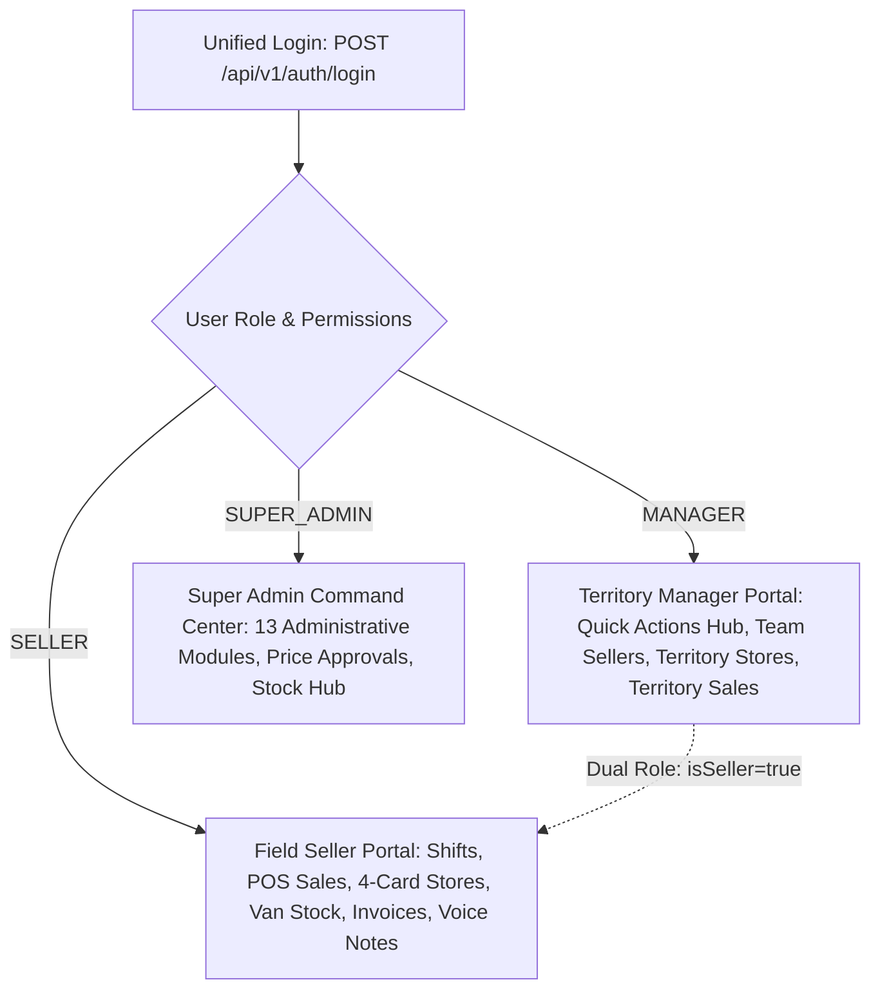
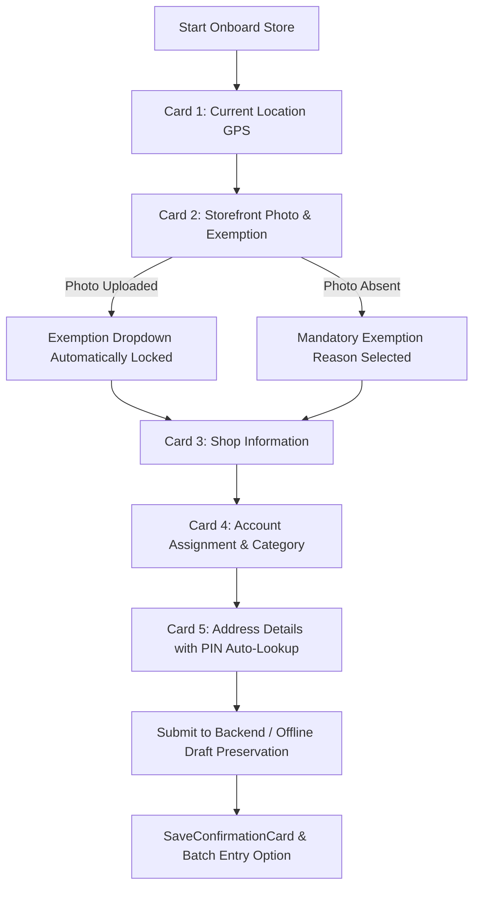

# FemmeFlo Mobile App Specification (`APP_SPEC.md`)

> **Document Version:** 1.2.0 (Phase 8 Production Release Specification)  
> **Target:** `femmeflo-app` (Expo SDK 58 / React Native 0.88.1 / React 19.3.0 / TypeScript ~6.0.3 / Expo Router ~58.0.31)  
> **App Version**: v1.0.20 (Android `versionCode: 24`)  
> **Reference Backend API:** `femmeflo-yfa-inventory-server` (Express 5 / Prisma / PostgreSQL on Supabase)  
> **Target Platform:** Android (Physical Devices & Emulators) with internal APK distribution  

---

## SECTION A: SYSTEM ARCHITECTURE & PORTAL OVERVIEW

The FemmeFlo mobile application is an enterprise-grade field distribution and territory management client designed for high-reliability rural and semi-urban FMCG sanitary product distribution in India.



### 1. In-Scope Portals

1. **Field Seller Portal (`(seller)`)**:
   - Duty shift start/end with native Biometric Fingerprint & Mobile PIN verification (`ShiftAuthVerificationModal.tsx`).
   - Customer onboarding via a standardized 4-card architecture with PIN code auto-lookup, GPS coordinates, and photo upload exemption locking.
   - Decoupled direct point-of-sale terminal (`/(seller)/sales/new`) for instant order booking without shift blockers.
   - Duty shift visit tracking (`/(seller)/shift`) supporting store check-in, checkout, and visit-linked sales.
   - Multilingual Voice Feedback Translation (Hindi/Hinglish speech-to-text translated into professional English field notes).
   - Van stock balance ledger, GST tax invoice download & native Android share sheet.
   - Commission and monthly incentive tracking.

2. **Territory Manager Portal (`(manager)`)**:
   - Executive territory dashboard with sales revenue, active field officer counts, and store metrics.
   - **Manager Quick Actions Hub (`/(manager)/quick-actions/index.tsx`)**: Safe area insets aligned operational launchpad providing one-tap access to New Sale, Daily Shift, Van Stock, Add New Shop, Manage Sellers, All Sales, and field helpline support.
   - Field officer management: Directory of supervised sellers, performance metrics, and seller onboarding (`/(manager)/sellers/new`).
   - Territory customer directory and sales stream with 4-card onboarding support.
   - Dual-role persona toggle: Seamless instant switching between Manager and Field Seller views for managers configured with `isSeller: true`.

3. **Super Admin Portal (`(admin)`)**:
   - Executive command center (`/(admin)/index`) displaying total revenue, packets sold, central warehouse stock, and pending approvals counter.
   - **Administrative Actions Hub (`/(admin)/actions/index.tsx`)**: Centralized command center covering all 13 operational capabilities across 6 functional categories.
   - Real-time Price Approvals queue (`/(admin)/approvals`) with side-by-side comparison of requested price vs minimum price, approval notes, and live event synchronization.
   - Multi-Warehouse Stock Movement Hub (`/(admin)/inventory/transfer`): Central warehouse transfers, factory inward stock receipt, and vehicle van allocations.
   - User lifecycle management (`/(admin)/users`), territory assignments, manager permissions, and price threshold configuration.

---

## SECTION B: CORE FUNCTIONAL SPECIFICATIONS

### 1. Customer Onboarding & Verification (4-Card Architecture)
Implemented in `src/app/(seller)/customers/new.tsx` and `src/app/(manager)/customers/new.tsx`:



- **Card 1: Current Location GPS Card**:
  - Automatically queries `expo-location` on mount (`startGps`).
  - Displays state: `acquiring` (with spinner), `acquired` (green checkmark), `error`, or `timeout`.
  - Displays detected District and State alongside GPS accuracy (in meters).
  - Provides a prominent "Change" / re-acquire button for manual GPS re-calibration in village areas.
- **Card 2: Storefront Photo & Verification Card**:
  - Image capture box supporting camera photo taking or gallery picker via `expo-image-picker` with JPEG compression.
  - Image preview with retake and remove actions.
  - **Automatic Exemption Locking**: When a storefront photo is captured, the *"Reason for not adding shopkeeper photo"* dropdown is automatically disabled and locked (`Storefront photo captured • Exemption not required`) with lock icon and green badge.
  - **Exemption Dropdown**: Required only when photo is absent. Provides 5 standardized options:
    1. *Poor network connectivity*
    2. *Customer refused photo*
    3. *Shopkeeper not present / closed*
    4. *Camera / device malfunction*
    5. *Indoor shop / poor lighting*
- **Card 3: Shop Information Card**:
  - Mandatory Shop / Store Name (`*`).
  - Mandatory Owner Name (`*`).
  - Mandatory Mobile Number (`*` with static `+91` prefix, validated to 10 digits).
  - Optional Email Address with RFC-compliant format validation.
- **Card 4: Account Assignment & Trade Category Card**:
  - **Strictly Dynamic Manager Selection**: No hardcoded managers. Dynamically queries `adminApi.listManagers` (or `managerApi.listSellers` fallback) with search filtering modal. Defaults cleanly to the active authenticated user if list is empty.
  - **Single Trade Category Dropdown**: Queries `categoriesApi.listCategories`, allowing assignment of retail outlet trade classification.
- **Card 5: Address Details Card**:
  - **PIN Code Auto-Lookup**: Typing a 6-digit PIN code triggers reverse lookup via postal API (`api.postalpincode.in`), automatically populating District, State, and Locality.
  - Street Address / Landmark (`*`).
  - Village / Locality (optional).
  - District (`*`) and State (`*`).
  - Interactive **Mini Map Address Preview** tile displaying landmark pin and formatted address string.
- **Post-Submission & Offline Drafts**:
  - Form state automatically autosaves to local draft storage (`draftStorage.saveCustomerDraft`).
  - Upon successful backend creation, clears draft and displays `SaveConfirmationCard` with summary details, server timestamp, GPS coordinates, and batch entry shortcut (`/(seller)/customers/bulk`).

---

### 2. Duty Shift Biometric & Mobile Password Authentication
Implemented in `src/components/common/ShiftAuthVerificationModal.tsx`:

- **Replaced Face Selfie Attendance**: Eliminates flaky camera-based face selfie attendance in favor of hardware-level Fingerprint / Biometric authentication.
- **Hardware Integration**:
  - Uses `expo-local-authentication` (`hasHardwareAsync`, `isEnrolledAsync`).
  - Tactile radar pulsing animation on the biometric sensor interface.
- **Mobile PIN / Password Fallback**:
  - Dedicated fallback tab allowing field officers to verify identity using their mobile account password or security PIN.
  - Validates credentials against `authApi.login` or active session context.
- **Backwards-Compatible Telemetry**:
  - Returns verification results mapped to legacy backend shift fields:
    ```typescript
    {
      verified: true,
      method: "FINGERPRINT" | "MOBILE_PASSWORD",
      confidence: 0.99,
      timestamp: "2026-11-15T...",
      faceVerified: true,
      facePhoto: method === "FINGERPRINT" ? "biometric_fingerprint_verified" : "mobile_password_verified",
      faceConfidence: 0.99,
      faceMethod: method === "FINGERPRINT" ? "FINGERPRINT_BIOMETRIC" : "MOBILE_PASSWORD"
    }
    ```
  - Preserves compatibility with backend shift controllers while sanitizing outbound payload to avoid server schema rejections.
- **Odometer Tracking**:
  - Shift start enforces positive vehicle odometer KM reading.
  - Shift end enforces `endOdometerKm >= startOdometerKm` with validation error handling.

---

### 3. Decoupled Direct Sales & Shift Visit Sales Flows
Implemented in `src/app/(seller)/sales/new.tsx` and `src/app/(seller)/shift/index.tsx`:

- **Decoupled Direct POS Sales**:
  - Field sellers and managers can record direct sales at any time without needing an active duty shift.
  - Eliminates field operational blocks when recording ad-hoc or over-the-counter orders.
- **Duty Shift Visit Sales**:
  - When on active duty shift, field officers can check into retail stores (`POST /api/v1/seller/shifts/check-in`).
  - On checkout, sellers can record visit outcomes ("No Sale" with standardized reason vs "Sale Done" with SKU items and payment mode).
- **POS Terminal Features**:
  - Searchable customer picker modal with customer balance tags.
  - Multi-line item SKU cart with fast increment/decrement steppers (`±1`, `±5`).
  - Real-time van stock balance validation against seller inventory to prevent overselling.
  - Floor price enforcement with amber warning pill (`#D97706`): orders priced below minimum price submit as `PENDING_APPROVAL` for Super Admin review.
  - Payment modes: Exactly `CASH`, `BANK` (with optional transaction reference), or `PENDING`.
  - **Idempotency Protection**: RFC4122 v4 UUID `requestKey` bound to order payload hash, rotating automatically if the cart or pricing is edited after a failed or interrupted submission.
  - Autosaves unsubmitted orders locally in AsyncStorage, restored automatically if the app is interrupted.

---

### 4. Manager Quick Actions Hub
Implemented in `src/app/(manager)/quick-actions/index.tsx`:

- **Screen Layout & Device Adaptation**:
  - Integrated with `react-native-safe-area-context` using dynamic padding:
    `paddingTop: Math.max(insets.top, Platform.OS === 'ios' ? 14 : 20) + 6`
  - Eliminates overlap with device status bars, camera notches, and punch-hole displays.
- **Hero Action Card**:
  - Prominent maroon card `#881337` linking directly to New Sale (`/(seller)/sales/new`).
- **5 Action Cards**:
  1. **Daily Shift**: Navigates to `/(seller)/shift` for punch-in and route visits.
  2. **Check Van Stock**: Navigates to `/(manager)/inventory` for mobile stock ledger.
  3. **Add New Shop**: Navigates to `/(manager)/customers/new` for 4-card onboarding.
  4. **Manage Sellers**: Navigates to `/(manager)/sellers` for field officer roster.
  5. **All Sales**: Navigates to `/(manager)/sales` for territory sales history.
- **Operational Support Card**:
  - One-tap phone call trigger to helpline: `tel:18001234567`.
  - Pre-filled email support trigger: `mailto:support@femmeflo.com?subject=Territory%20Operations%20Support`.
- **Stylized Heritage Footer**:
  - Vector silhouette of Indian architectural monument skyline with fluid maroon wave accent.

---

### 5. Administrative Actions Command Center (13 Modules)
Implemented in `src/app/(admin)/actions/index.tsx`:

Centralized command center categorizing all 13 core operational modules:

| # | Action Module | Route | Category | Icon / Indicator |
| :---: | :--- | :--- | :--- | :--- |
| **1** | **Daily Sales & Reports** | `/(admin)/reports` | Sales & Reports | `bar-chart-outline` |
| **2** | **Price Approvals** | `/(admin)/approvals` | Approvals | `checkmark-done-circle-outline` (Live pending alert badge `#DC2626`) |
| **3** | **Products & Prices** | `/(admin)/products` | Products & Stock | `cube-outline` |
| **4** | **GST Tax Invoices** | `/(admin)/invoices` | Sales & Reports | `document-text-outline` |
| **5** | **Sales Orders** | `/(admin)/sales` | Sales & Reports | `receipt-outline` |
| **6** | **Incentives & Payouts** | `/(admin)/incentives` | Sales & Reports | `cash-outline` |
| **7** | **Staff Shifts & Routes** | `/(admin)/shifts` | Field Team | `compass-outline` |
| **8** | **Manager Permissions** | `/(admin)/permissions` | Team & Access | `shield-checkmark-outline` |
| **9** | **Shops & Customers** | `/(admin)/customers` | Field Team | `storefront-outline` |
| **10** | **Stock Movement Hub** | `/(admin)/inventory/transfer` | Products & Stock | `swap-horizontal-outline` |
| **11** | **Regional Warehouses** | `/(admin)/inventory/new` | Products & Stock | `business-outline` |
| **12** | **Managers & Sellers** | `/(admin)/users` | Team & Access | `people-outline` |
| **13** | **Shop Categories** | `/(admin)/categories` | Settings | `pricetags-outline` |
| **14** | **Company Settings** | `/(admin)/settings` | Settings | `settings-outline` |

- **Real-Time Synchronization**: Listens to `DeviceEventEmitter` event `APPROVAL_STATUS_CHANGED` to immediately update pending approval counts without manual page refresh.

---

### 6. Multilingual Voice Feedback Translation
Implemented in `src/components/common/VoiceFeedbackTranslator.tsx`:

- **Speech Recognition Engine**: Utilizes `expo-speech-recognition` (`SpeechRecognizer` utility) with browser web speech fallback.
- **Multilingual Support**: Supports `hi-IN` (Hindi Devanagari), `en-IN` (Indian English), and romanized Hinglish phonetic speech.
- **Translation Pipeline**:
  - Captures spoken speech transcript.
  - Calls `translateHindiOrHinglishToEnglish` (`src/api/translate.ts`) to produce crisp, professional English field notes.
  - Displays side-by-side translation audit modal with original transcript and translated English.
  - Allows field officer to review and manually edit translated text before applying.
- **Pre-Built Village Field Chips**:
  - *"Dukaan band thi owner gaon gaya hai"* (Shop closed, owner out of village)
  - *"Payment kal aayega sample de diya hai"* (Payment promised tomorrow, trial sample provided)
  - *"Shopkeeper requested restock next week"*
  - *"Customer very satisfied with pad softness"*
  - *"Competitor sample offered at lower rate"*
  - *"Payment promised via UPI in 2 days"*
- **Field Integration**: Integrated directly into POS sales creation (`sales/new.tsx`) and shift visit checkout (`shift/index.tsx`).

---

## SECTION C: DATA INTEGRITY & OFFLINE RESILIENCE

1. **Authentication Storage**:
   - Authentication JWT stored in hardware-backed `expo-secure-store` (`femmeflo_mobile_auth_token`).
   - Session restoration verifies `/auth/me` on launch.
   - On 401 Unauthorized, token is purged, but active shift and order drafts are strictly preserved.
2. **Draft Storage (`draftStorage.ts`)**:
   - Order drafts saved with payload hash and idempotency UUID.
   - Customer onboarding drafts autosaved and restored.
   - Active shift cached locally to survive server restarts or temporary 500 errors.
3. **Idempotency**:
   - Dual submission prevention using `X-Idempotency-Key` header and body `requestKey`.
   - Rotates key if payload is modified after submit attempt.
4. **Validation Suite**:
   - Strict TypeScript typechecking with zero compiler errors.
   - 356 automated unit and scenario tests verifying business rules, offline resilience, and UI workflows.
