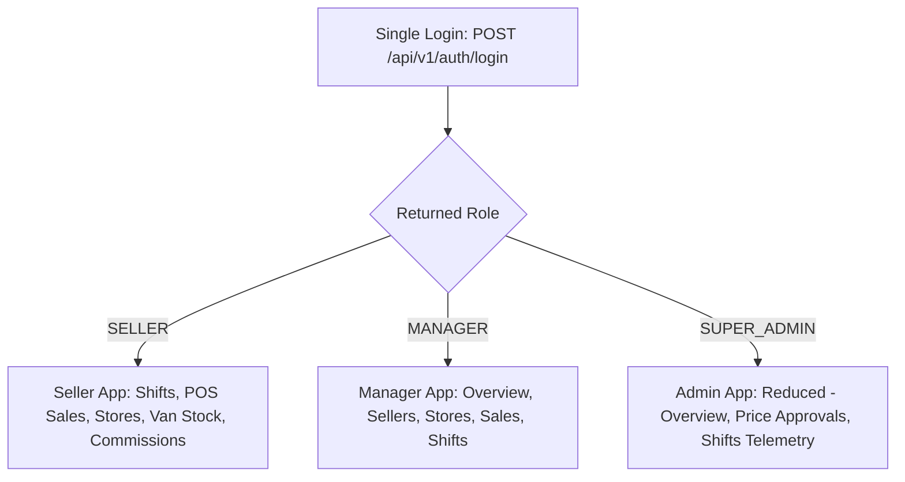

# FemmeFlo Mobile App Specification (`APP_SPEC.md`)

> **Document Version:** 1.1.0 (Phase 1 Approved Specification with Code-Derived Truth)  
> **Target:** `femmeflo-app` (Expo SDK 58 / React Native 0.88 / TypeScript / Expo Router)  
> **Reference Web App:** `femmeflo-website` (Next.js 16 / React 19 / Tailwind CSS v4)  
> **Reference Backend API:** `femmeflo-yfa-inventory-server` (Node.js / Express 5 / Prisma / PostgreSQL on Supabase)  
> **Author:** Senior React Native / Expo Systems Architect  

---

## SECTION A: WEBSITE ANALYSIS & SCOPE

### 1. In-Scope Portals & Build Order

Per user instruction:
1. **Public Marketing Pages Skipped**: Focus exclusively on authenticated enterprise operational workflows.
2. **Build Order**:
   - **Stage 1 (Primary)**: **Field Seller Portal** (`(seller)`) — Duty shifts, retail store directory & customer onboarding, van stock inventory balance, POS sales order creation with pricing approval checks, line items, and monthly commission tracking.
   - **Stage 2**: **Territory Manager Portal** (`(manager)`) — Supervised field seller roster, territory store directory, territory sales ledger, and active shift monitoring.
   - **Stage 3**: **Super Admin Portal** (`(admin)` - Reduced Scope) — Executive National Overview, Below-Minimum Price Approval Queue, and National Shifts Telemetry only.



### 2. Multi-Role Capability Audit
- In `prisma/schema.prisma`, `User.role` is a single enum: `SUPER_ADMIN`, `MANAGER`, `SELLER`.
- **Dual Role Exception**: A `MANAGER` can additionally have `isSeller: true` in the database. When `isSeller: true`, the manager is allocated a van stock location, can initiate duty shifts, and can execute POS sales.
- **Pure Roles**: Pure `SELLER` and `SUPER_ADMIN` accounts hold only a single role.
- **Routing Decision**: Route directly based on `data.user.role`. For managers with `isSeller: true`, provide a simple toggle pill in the header to switch between Manager and Field Seller views.

---

## SECTION B: BACKEND ARCHITECTURE & CODE-DERIVED API INVENTORY

### 1. Framework, Security & Networking

- **Framework**: Express 5.2.1, TypeScript 5, Prisma ORM 7.10, PostgreSQL on Supabase.
- **Authentication**: JWT (`HS256`, 30-day lifetime) with server-side `tokenVersion` check.
- **Session Preservation on 401**: Global 401 interceptor purges the expired JWT and prompts re-login, but explicitly **preserves active in-progress shift state and unsubmitted order drafts** in persistent storage (`expo-secure-store` / AsyncStorage).
- **Location Requirements**: The server tracks **point events only** (`/start`, `/check-in`, `/check-out`, `/end`). There are **NO periodic background location pings or WebSocket streams**. Therefore, the mobile app uses **foreground location only** (`expo-location` with `requestForegroundPermissionsAsync`), avoiding intrusive background location permissions.
- **Photo Compression**: Standardized on **JPEG** compression (`ImageManipulator.SaveFormat.JPEG` at quality 0.8) to eliminate cross-platform WebP encoding bugs on iOS devices. The backend server automatically converts inbound JPEG/PNG images to WebP via `sharp` in `storage.service.ts`.

---

### 2. Code-Derived API Inventory & Exact Zod Schemas

#### 2.1 Authentication: `POST /api/v1/auth/login`
- **Controller**: `src/controller/auth/auth.controller.ts`
- **Request Body** (strict JSON):
  ```json
  {
    "login": "seller@femmeflo.in", // Email or phone number (+91...)
    "password": "Password123!"     // 12 to 72 UTF-8 bytes
  }
  ```
- **Response** (HTTP 200):
  ```json
  {
    "success": true,
    "message": "Login successful",
    "data": {
      "token": "eyJhbGciOi...",
      "tokenType": "Bearer",
      "expiresInSeconds": 2592000,
      "user": {
        "id": "UUID",
        "name": "Ananya Sharma",
        "email": "seller@femmeflo.in",
        "phone": "+919876543210",
        "role": "SELLER", // "SUPER_ADMIN" | "MANAGER" | "SELLER"
        "isSeller": true,
        "active": true,
        "district": "Raipur",
        "state": "Chhattisgarh",
        "village": "Abhanpur",
        "permissions": []
      }
    }
  }
  ```

---

#### 2.2 Field Sales: `POST /api/v1/seller/sales`
- **Validator**: `src/controller/sales.validation.ts` (`createSaleSchema`)
- **Headers**:
  - `Authorization: Bearer <token>`
  - `X-Idempotency-Key: <UUID>` *(Generated at draft creation time and persisted with draft)*
- **Request Body** (`z.strictObject`):
  ```json
  {
    "customerId": "8f2a1b9c-...",
    "items": [
      {
        "productId": "4d1b7a2c-...",
        "quantity": 10,
        "unitPricePaise": 2500
      }
    ],
    "paymentMode": "CASH", // "CASH" | "BANK" | "PENDING"
    "requestKey": "UUID"   // Persisted idempotency key
  }
  ```
  *(Legacy single-item syntax `{ customerId, quantity, unitPricePaise, paymentMode, requestKey }` is also accepted via `z.union`).*
- **Response** (HTTP 201):
  ```json
  {
    "success": true,
    "message": "Sale confirmed successfully", // Or "Sale recorded and sent for low-price approval"
    "data": {
      "sale": {
        "id": "UUID",
        "sellerId": "UUID",
        "customerId": "UUID",
        "quantity": 10,
        "unitPricePaise": 2500,
        "totalPaise": 25000,
        "paymentMode": "CASH",
        "status": "CONFIRMED", // "CONFIRMED" | "PENDING_APPROVAL"
        "requestKey": "UUID",
        "createdAt": "2026-10-29T10:00:00.000Z",
        "lineItems": [
          {
            "id": "UUID",
            "productId": "UUID",
            "quantity": 10,
            "unitPricePaise": 2500,
            "totalPaise": 25000
          }
        ]
      }
    }
  }
  ```

---

#### 2.3 Customer Store Onboarding: `POST /api/v1/seller/customers`
- **Controller**: `src/controller/customer.controller.ts`
- **Middleware**: `uploadCustomerPhotoMiddleware` (`multer.memoryStorage()`, field name `"photo"` or `"image"`, max 5MB).
- **Request Format**: `multipart/form-data`
- **Fields**:
  - `shopName` (string, 1-100 chars, required)
  - `contactName` (string, 1-100 chars, required)
  - `phone` (string, Indian phone format `+91...`, required)
  - `email` (string, email format, optional)
  - `categoryId` (UUID, required)
  - `shopNumber` (string, optional)
  - `streetName` (string, optional)
  - `pincode` (string, 6-digit regex `/^[1-9][0-9]{5}$/`, optional)
  - `address` (string, max 500 chars, optional)
  - `state` (string, required)
  - `district` (string, required)
  - `village` (string, required)
  - `latitude` (number/string, validated within India boundary: 6.0 to 38.0 N)
  - `longitude` (number/string, validated within India boundary: 68.0 to 98.0 E)
  - `accuracy` (number, optional GPS accuracy radius)
  - `photo` (binary JPEG image file stream, optional)
- **Response** (HTTP 201):
  ```json
  {
    "success": true,
    "message": "Customer created with photo",
    "data": {
      "customer": {
        "id": "UUID",
        "shopName": "Radha Medical Stores",
        "contactName": "Radha Bai",
        "phone": "+919876543210",
        "state": "Chhattisgarh",
        "district": "Raipur",
        "village": "Abhanpur",
        "address": "Shop 4, Main Road, Abhanpur, Raipur, Chhattisgarh",
        "photoPath": "https://<supabase-bucket>/customers/...webp",
        "latitude": 21.0543,
        "longitude": 81.7456,
        "active": true
      },
      "photoUrl": "https://<supabase-bucket>/customers/...webp"
    }
  }
  ```

---

#### 2.4 Duty Shifts: `POST /api/v1/seller/shifts/*`
- **Start Shift** (`POST /api/v1/seller/shifts/start`):
  - Body (`z.strictObject`): `{ "latitude": 21.25, "longitude": 81.63, "address": "Raipur Depot" }`
  - Response: `{ "success": true, "data": { "shift": { "id": "UUID", "status": "ACTIVE", "startTime": "..." } } }`
- **Store Visit Check-In** (`POST /api/v1/seller/shifts/check-in`):
  - Body: `{ "shiftId": "UUID", "customerId": "UUID", "shopName": "Radha Medical", "latitude": 21.25, "longitude": 81.63 }`
  - Response: `{ "success": true, "data": { "visit": { "id": "UUID", "checkInTime": "..." } } }`
- **Store Visit Check-Out** (`POST /api/v1/seller/shifts/check-out`):
  - Body: `{ "visitId": "UUID", "notes": "Supplied 10 pkts, owner interested in larger pack" }`
  - Response: `{ "success": true, "data": { "visit": { "id": "UUID", "durationMins": 14.5 } } }`
- **End Shift** (`POST /api/v1/seller/shifts/end`):
  - Body: `{ "shiftId": "UUID", "latitude": 21.25, "longitude": 81.63, "address": "Raipur Depot", "notes": "Closing shift" }`
  - Response: `{ "success": true, "data": { "shift": { "id": "UUID", "status": "COMPLETED", "totalDistanceKm": 24.2 } } }`

---

#### 2.5 Price Approvals: `POST /api/v1/admin/approvals/:saleId/*`
- **List Pending** (`GET /api/v1/admin/approvals`):
  - Returns array of `Sale` records with `status: "PENDING_APPROVAL"` and populated `lineItems`, `customer`, and `seller`.
- **Approve** (`POST /api/v1/admin/approvals/:saleId/approve`):
  - Param: `saleId: UUID`
  - Response (HTTP 200): `{ "success": true, "message": "Sale approved and confirmed successfully", "data": { "sale": { ... } } }`
- **Reject** (`POST /api/v1/admin/approvals/:saleId/reject`):
  - Param: `saleId: UUID`
  - Body (`z.strictObject`): `{ "reason": "Price is below minimum allowed margin" }` (optional, max 500 chars)
  - Response (HTTP 200): `{ "success": true, "message": "Sale rejected", "data": { "sale": { "status": "REJECTED" } } }`

---

#### 2.6 Invoice PDF Streaming: `GET /api/v1/invoices/:id/pdf`
- **Authentication**: Supported via **both** header `Authorization: Bearer <token>` and query parameter `?token=<token>`.
- **Download via `expo-file-system`**:
  ```typescript
  const fileUri = `${FileSystem.documentDirectory}Invoice-${saleNumber}.pdf`;
  await FileSystem.downloadAsync(
    `${API_URL}/invoices/${invoiceId}/pdf?download=true`,
    fileUri,
    {
      headers: {
        Authorization: `Bearer ${token}`,
      },
    }
  );
  await Sharing.shareAsync(fileUri, { mimeType: "application/pdf" });
  ```

---

## SECTION C: BACKEND BLOCKERS & DEFICIENCIES

In strict compliance with project Hard Rules, the following backend limitations are documented:

### 1. Carrier-Grade NAT (CGNAT) Lockout Risk on Auth Rate Limiter
- **Problem**: `authRateLimiter` enforces a strict limit of **20 attempts per 15 minutes per IP address** (`windowMs: 15 * 60 * 1000, limit: 20`). In India, major telecom networks (Reliance Jio, Bharti Airtel, Vodafone Idea) group hundreds of mobile subscribers onto shared Carrier-Grade NAT (CGNAT) gateway IPs. If multiple field sales officers share the same mobile tower gateway, 20 failed or concurrent login requests will lock out **all field officers on that cellular gateway** with HTTP 429 ("Too many authentication attempts").
- **Exact Server Fix Required**: Modify `femmeflo-yfa-inventory-server/src/middleware/rate-limit.middleware.ts` to key the limiter on the normalized login identifier instead of raw IP, or pass a client installation UUID:
  ```typescript
  keyGenerator: (req) => {
    const login = req.body?.login ? String(req.body.login).trim().toLowerCase() : "";
    return login ? `${req.ip}_${login}` : req.ip;
  }
  ```
- **Mobile Client Workaround**: Provide clear user feedback on HTTP 429 with countdown timer derived from `Retry-After` header, and avoid automated background login retries.

### 2. Storefront Photo Multipart vs Signed URLs
- **Status Resolved**: Server **already mounts** `uploadCustomerPhotoMiddleware` (Multer) directly on `POST /api/v1/seller/customers` and `POST /api/v1/seller/customers/:id/photo`. The server compresses the photo via `sharp` and stores it in Supabase Storage using its private backend service role key, returning the public URL. No signed URL endpoint or client-side Supabase credentials are required.

---

## SECTION D: PHASE 2 STITCH DESIGN PLAN (SELLER SCREENS FIRST)

Per user directive, we proceed immediately to **Phase 2 (Stitch Design)** focusing on the **Field Seller** screens first.

### Seller Screen Inventory for Stitch Design:
1. **Screen 1: Seller Duty Home (`/(seller)/index`)**: Shift status card (On/Off Duty indicator), live duty timer, today's sales metrics, quick POS trigger.
2. **Screen 2: Duty Shift Clock & Visit Logger (`/(seller)/shifts`)**: Foreground GPS capture, active shift timer, customer store check-in/out, distance counter.
3. **Screen 3: POS New Order Terminal (`/(seller)/sales/new`)**: Customer store picker, SKU list cards with available van stock badge, price input with below-minimum amber warning pill, payment mode selector (`CASH`, `BANK`, `PENDING`), submit action with persisted idempotency key.
4. **Screen 4: Order Details & Tax Invoice (`/(seller)/sales/[id]`)**: Order status header, line items table, PDF tax invoice download button with native share sheet trigger, payment collection action for credit orders.
5. **Screen 5: Customer Store Directory & Onboarding (`/(seller)/customers`, `/(seller)/customers/new`)**: Store list with one-tap phone dialer and GPS navigation, store registration form with camera photo capture and foreground GPS coordinates.
6. **Screen 6: Van Stock Balance (`/(seller)/inventory`)**: Current allocated, sold, and remaining packet count in sales vehicle.
7. **Screen 7: Commission & Incentive Ledger (`/(seller)/incentives`)**: Current month earned incentives, payout status, historical rate lock notice.
