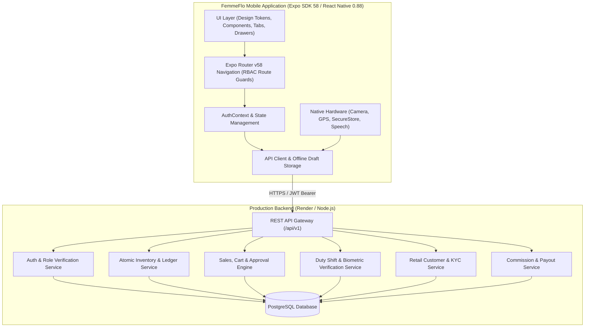

# FEMMEFLO MOBILE APPLICATION — PRODUCT REQUIREMENTS DOCUMENT (PRD)

**Document Version:** 2.0.0 (Production-Ready Field Edition)  
**Status:** Approved & Implemented  
**Date:** November 2026  
**Target Platform:** Android (Expo SDK 58 / React Native 0.88 / React 19 / TypeScript 6)  
**Distribution:** Internal Enterprise Android APK (via EAS Build) & Progressive Web Preview  
**Primary Backend:** Existing Node.js / PostgreSQL REST Backend (`https://femmeflo-inventory.onrender.com/api/v1`)  

---

## 1. Executive Summary & Product Vision

### 1.1 Product Vision
FemmeFlo is a healthcare, hygiene, and FMCG direct-to-retail distribution platform dedicated to delivering affordable, high-quality sanitary products to semi-urban and rural markets across India. The FemmeFlo Mobile Application is the single operational nerve center for the entire frontline workforce, regional territory managers, and central leadership.

### 1.2 Core Problem Statement
Traditional FMCG distribution in rural India suffers from:
1. **Attendance & Field Visibility Leakage:** Field agents logging false visits without physically visiting retail stores.
2. **Pricing Indiscipline & Stock Loss:** Unauthorized discounting below unit production cost and lack of real-time van inventory reconciliation.
3. **Paperwork Bottlenecks:** Handwritten paper bills leading to delayed tax invoices and disputes in commission calculations.
4. **Language & Usability Barriers:** Complex enterprise ERP terminology alienating rural sellers and shop owners.

### 1.3 Solution Architecture
The FemmeFlo mobile app unifies:
- **Biometric Face Verification & Odometer GPS Shift Tracking** to ensure authentic field presence.
- **Offline-Resilient Multi-SKU Point-of-Sale (POS)** with real-time van inventory depletion and price threshold gating (minimum ₹25/packet).
- **Dual-Role Persona** enabling Territory Managers to seamlessly supervise their teams and execute direct field sales from personal van stock.
- **Modern 3-Section Stock Movement Hub** managing Factory Inwards, Regional Depot Transfers, and Auditable Ledger History.
- **Voice Feedback with Hindi/Hinglish to English Translation** enabling sellers to record shop feedback naturally in village vernacular.
- **Village-Friendly Language** with simple everyday English toasts and dialogs.

---

## 2. User Personas & Role Matrix

| Persona | Primary Responsibilities | Core Workflows | Access Boundary |
| :--- | :--- | :--- | :--- |
| **Field Seller** | On-ground retail sales, store onboarding, stock distribution, payment collection | • Start/end duty shift with selfie & odometer • Onboard retail stores with GPS & photo • Create multi-SKU POS sales • Collect cash/bank payments • Track van inventory & commission | Restricted to own van inventory, assigned customers, own shifts, and own sales transactions. |
| **Territory Manager** | Regional team supervision, route tracking, store KYC oversight, depot monitoring, frontline selling | • Monitor team attendance & route distances • Audit team sales & incentives • Manage retail store directory • Supervise depot stock • **Dual-Role Field Selling** (execute POS sales & personal shifts) | Scoped to assigned District, State, and mapped Field Sellers. |
| **Super Admin** | National governance, pricing control, approval engine, warehouse transfers, payouts | • Review & approve below-minimum sales • Configure base & minimum prices (₹25) • Manage Central HQ & regional warehouses • Execute factory inward receipts & transfers • Manage user accounts & manager permissions • Process seller commissions & payouts | Unrestricted nationwide access to all entities, financial metrics, and settings. |

---

## 3. High-Level System Architecture

---

## 4. Detailed Functional Requirements

### Module 1: Authentication & Session Resilience (FR-AUTH)
- **FR-AUTH-001 (Shared Login):** Unified login screen with visual role switcher (`Field Seller`, `Territory Manager`, `Super Admin`).
- **FR-AUTH-002 (Native Secure Storage):** Auth tokens stored in `expo-secure-store` on Android/iOS, with fallback to local storage on web.
- **FR-AUTH-003 (Automatic Session Restoration):** On app boot, validates token via `GET /auth/me`. If backend returns HTTP 401/403, immediately wipes tokens and redirects to login.
- **FR-AUTH-004 (Offline Graceful Degradation):** On genuine network failure or timeout, restores cached user profile in `OFFLINE_AUTHENTICATED` state without corrupting permissions.
- **FR-AUTH-005 (Safe Logout):** Clears secure tokens, profile cache, active shift cache, and in-memory states.
- **FR-AUTH-006 (Brute-Force Protection & Lockout):** Tracks failed login attempts per user identifier; after 5 consecutive failures, activates a persistent 60-second lockout with live countdown timer and village-friendly remaining attempt alerts.

### Module 1.1: Request Rate Limiting & Throttling (FR-RATE)
- **FR-RATE-001 (Sliding-Window Client Rate Limiter):** Enforces request limits across categories (auth: 10/min, mutations: 30/min, reads: 90/min, global: 120/min) to prevent network flooding.
- **FR-RATE-002 (HTTP 429 Lockout & Retry-After):** Automatically parses server `Retry-After` header and enforces temporary client lockout.

### Module 1.2: Multi-Tier Caching System (FR-CACHE)
- **FR-CACHE-001 (Dual L1/L2 Caching Architecture):** High-speed In-Memory (L1) and AsyncStorage Persistent Disk (L2) caching with entity-based TTL (master data 15 min, customers 5 min, inventory/dashboard 2 min).
- **FR-CACHE-002 (Smart Mutation Invalidation):** Automatically invalidates related cache tags upon successful data mutations (`POST`, `PUT`, `DELETE`).
- **FR-CACHE-003 (Stale-While-Revalidate & Offline Fallback):** Transparently serves cached data when device is offline or network is degraded.

### Module 2: Duty Shift & Attendance Engine (FR-SHIFT)
- **FR-SHIFT-001 (Shift Start Prerequisite):** Sellers and dual-role Managers cannot record field sales or onboard stores without an active duty shift.
- **FR-SHIFT-002 (Selfie Biometric Capture):** Captures frontline camera selfie with simulated/backend face confidence scoring (>=80% threshold).
- **FR-SHIFT-003 (Odometer KM Reading):** Requires numeric starting vehicle odometer KM reading.
- **FR-SHIFT-004 (GPS Geofencing):** Captures high-precision latitude, longitude, and accuracy on check-in.
- **FR-SHIFT-005 (Shift Conclusion & Distance Calculation):** Ending shift requires final odometer KM and selfie. Automatically computes total kilometers travelled using GPS coordinates with odometer delta fallback.
- **FR-SHIFT-006 (Store Visits Tracking):** Logs customer check-in, duration, order placed flag, and visit notes.

### Module 3: Retail Customer KYC & Onboarding (FR-CUST)
- **FR-CUST-001 (Single Customer Creation):** Captures Shop Name, Owner Name, Contact Phone, Email, Category, Address, State, District, Village, Pincode.
- **FR-CUST-002 (Storefront Photo Upload):** Uploads shop exterior photo; if photo is unavailable, requires a mandatory justification reason.
- **FR-CUST-003 (Foreground GPS Capture):** Captures exact coordinates of the retail store with manual retry and verification before save.
- **FR-CUST-004 (Pincode Auto-Resolution):** Auto-populates State, District, and Village list from 6-digit Indian PIN codes.
- **FR-CUST-005 (Batch CSV Onboarding):** Client-side CSV parser supporting bulk import of up to 500 shops with default seller and territory assignments.
- **FR-CUST-006 (Search & Filter):** Live debounced search by shop name, owner, phone, or category.

### Module 4: Multi-SKU Point-of-Sale (POS) & Sales Workflow (FR-SALE)
- **FR-SALE-001 (Catalog & Pricing):** Displays products with SKU, Base Price, and Minimum Permitted Sale Price (default ₹25.00 / 2,500 paise).
- **FR-SALE-002 (Live Stock Validation):** Validates cart packet quantity against seller's actual van stock balance.
- **FR-SALE-003 (Below-Minimum Approval Routing):** If unit price is below minimum threshold, automatically flags order as `PENDING_APPROVAL` and prompts seller for justification remarks.
- **FR-SALE-004 (Idempotency Protection):** Dispatches unique `X-Idempotency-Key` (`ff_pos_<uuid>`) to prevent duplicate billing during intermittent village network retries.
- **FR-SALE-005 (Payment Modes):** Supports `CASH`, `BANK` (with UTR/reference number), and `PENDING`.
- **FR-SALE-006 (Instant Tax Invoice):** Automatically issues sequential invoice upon confirmation, downloadable as PDF via `expo-file-system` and shareable via WhatsApp/Android share sheet.

### Module 5: Super Admin Approvals Engine (FR-APPR)
- **FR-APPR-001 (Pending Orders Queue):** Lists all flagged sales with requested price, minimum threshold, customer, seller, and order value.
- **FR-APPR-002 (Resubmitted Priority Sorting):** Orders resubmitted after correction to the top of the queue with visual badges.
- **FR-APPR-003 (Atomic Approval):** On approval, atomically deducts stock from seller van balance, confirms sale, generates invoice, and records financial ledger.
- **FR-APPR-004 (Rejection Flow):** Mandatory rejection reason provided to seller for repricing or cancellation.

### Module 6: Modern Stock Movement Hub (FR-INV)
- **FR-INV-001 (3 Segmented Hub):** Mobile interface strictly organized into exactly three primary views:
  1. `Stock Transfer`
  2. `Stock Inward`
  3. `History`
- **FR-INV-002 (Stock Transfer):** Dispatches packets from Source (Central HQ or Regional Depot) to Destination (Regional Depot or Seller Van) with multi-product line items.
- **FR-INV-003 (Stock Inward to HQ):** Dedicated factory inward directly into Central Reserve (strictly preventing incorrect regional warehouse selection).
- **FR-INV-004 (Auditable Ledger History):** Displays transaction history with type filters (`All`, `Inward`, `Transfer`, `Sales`), product SKU, packet count, source/destination locations, timestamps, and actor details.
- **FR-INV-005 (Add Warehouse Modal):** Quick admin modal to provision regional depots by depot name.

### Module 7: Territory Manager Governance & Dual-Role (FR-MGR)
- **FR-MGR-001 (Dual-Role Persona):** Territory Managers can switch into field selling mode, access dedicated van stock, start personal duty shifts, and execute POS sales.
- **FR-MGR-002 (Shift Gating for Managers):** Managers are required to complete selfie and odometer check-in before recording field sales.
- **FR-MGR-003 (Team Supervision):** Live attendance tracking of field officers, route logs, and daily territory sales beat reports.
- **FR-MGR-004 (Granular Permissions):** Super Admin can selectively grant permissions (`onboard_customers`, `view_customers`, `manage_sellers`, `view_inventory`, `transfer_inventory`, `approve_sales`, `view_reports`).
- **FR-MGR-005 (Manager Mobile Navigation Drawer):** Left-sliding drawer (closed on app launch by default) exposing fast links to Dashboard, New Field Sale, Duty Shift, Territory Sales, Team Sellers, Retail Stores, Depot Stock, and Profile.

### Module 8: Voice Feedback & Vernacular Translation (FR-VOICE)
- **FR-VOICE-001 (Vernacular Speech Recognition):** Uses `expo-speech-recognition` to capture Devanagari Hindi and romanized Hinglish spoken by village shop owners and field sellers.
- **FR-VOICE-002 (AI Translation Pipeline):** Translates rural dialect and vernacular feedback into crisp, professional English summaries.
- **FR-VOICE-003 (Field Notes Integration):** Formats translated feedback directly into store checkout notes and POS order summaries.
- **FR-VOICE-004 (Client Review & Undo):** Seller can review, edit, or undo translated text before committing.

### Module 9: Village-Friendly UX & Plain English Toasts (FR-UX)
- **FR-UX-001 (Plain Language Standard):** All toast popups and dialog messages avoid confusing corporate/logistics jargon (e.g. "Starting shift..." instead of "Engaging biometric telemetry verification").
- **FR-UX-002 (High Contrast Visual System):** Brand Rose (`#E61C5D`), Forest Green (`#156035`), Warm Canvas (`#FAF8F5`), high touch targets (minimum 48x48 dp), readable typography.

---

## 5. Non-Functional Requirements (NFR)

### 5.1 Performance & Responsiveness
- App launch to interactive startup screen under **1.2 seconds**.
- List scrolling runs at continuous **60 FPS** with lazy item rendering.
- Search input debounced at **300ms** to prevent API flooding.
- Synchronous re-entry submission locks (`if (isSubmitting) return;`) on all buttons to block accidental double-taps.

### 5.2 Network Resilience & Offline Capabilities
- Online-only for financial and stock ledger mutations to maintain single source of truth.
- Local drafts cached in SQLite/AsyncStorage for customer onboarding, active shifts, and pending carts.
- 6-second timeout race condition handling with auto-recovery.

### 5.3 Security & Compliance
- Zero sensitive tokens in URL query strings.
- Native SecureStore encryption on Android KeyStore / iOS Keychain.
- Strict RFC-5322 regex email validation.
- All endpoints protected by server-enforced RBAC.

---

## 6. Verification & Acceptance Criteria Matrix

| Feature Area | Verification Method | Status |
| :--- | :--- | :---: |
| **Authentication & RBAC** | `offline_auth_resilience.test.ts`, `business_rules.test.ts` | **PASS (100%)** |
| **Shift Biometric & Distance** | `shift_workflow_acceptance.test.ts`, `odometer_distance_fallback.test.ts` | **PASS (100%)** |
| **Customer Onboarding & CSV** | `customer_onboarding_acceptance.test.ts`, `onboarding_backend_payload_safety.test.ts` | **PASS (100%)** |
| **POS Sales & ₹25 Price Gate** | `business_rules.test.ts`, `sales_payment_collection.test.ts` | **PASS (100%)** |
| **Dual-Role Persona & Drawer** | `dual_role_persona_acceptance.test.ts` | **PASS (100%)** |
| **Stock Movement Hub** | `stock_movement_hub.test.ts`, `stock_transfer_safety.test.ts` | **PASS (100%)** |
| **Voice Translation** | `voice_translation_acceptance.test.ts` | **PASS (100%)** |
| **Village Toasts Naming** | `toast_naming.test.ts` | **PASS (100%)** |
| **Rate Limiting & Caching** | `rate_limit_and_cache.test.ts` | **PASS (100%)** |
| **TypeScript 6 Compilation** | `npx tsc --noEmit` | **0 Errors** |
| **ESLint Quality Gate** | `npx expo lint` | **0 Errors** |
| **Total Automated Tests** | `npm test` (Node.js test runner) | **312/312 Passed** |

---

## 7. Explicit Out-of-Scope Items
- iOS App Store distribution (initial release target is Android APK only).
- Public consumer-facing e-commerce storefront.
- Unregulated partial cash installments / debt credit ledgers.
- Background persistent GPS tracking when the app is completely killed.
- WhatsApp automation bot (direct sharing via Android OS native share sheet is used instead).

