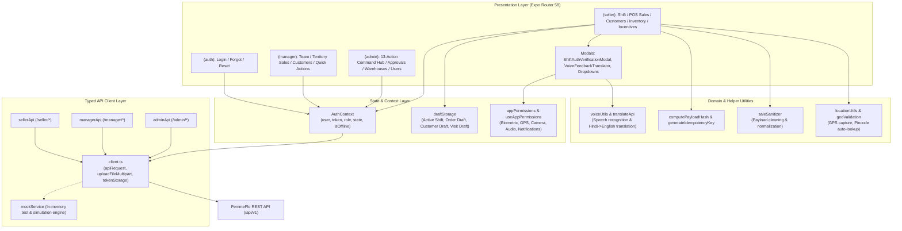
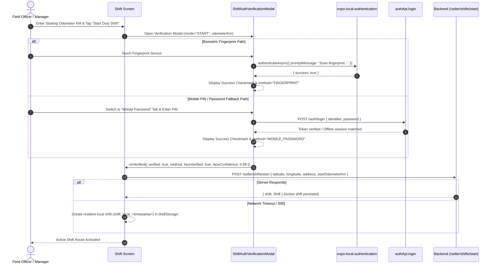

# SYSTEM ARCHITECTURE — FemmeFlo Mobile Application

## 1. Architecture Summary

FemmeFlo Mobile is an enterprise-grade field operations and territory management mobile application built for Android and iOS using **Expo SDK 58 (~58.0.25)**, **React Native 0.88.1**, and **React 19.3.0**, powered by the Hermes JavaScript engine and Expo Router v58 file-based navigation.

The application serves three distinct enterprise user roles:
1. **Field Sellers (SELLER):** Daily attendance and shift logging, retail customer onboarding with GPS and photo capture, point-of-sale order booking, direct sales recording, and speech-to-text Hindi/Hinglish customer feedback translation.
2. **Territory Managers (MANAGER):** Supervisory oversight of field officers, team stock tracking, secondary sales recording (dual-role field sales capability), customer allocation, and performance monitoring.
3. **Super Administrators (SUPER_ADMIN):** National command center covering 13 administrative domains, including low-price sales approval queues, factory inventory receipts, inter-warehouse and van stock transfers, territory manager/seller administration, and master business settings.

The mobile client is completely decoupled from direct database access. All data mutations, business rules, price floor checks, stock deductions, and commissions are enforced server-side via authenticated REST APIs over HTTPS with Bearer JWT tokens. To guarantee continuous field operations in rural and connectivity-sparse regions, the client incorporates an offline-first architecture utilizing native `@react-native-async-storage/async-storage`, `expo-secure-store`, and a persistent draft storage engine (`draftStorage`).

```text
Android / iOS Physical Device
└── FemmeFlo Client (Expo SDK 58 / React Native 0.88.1 / React 19.3.0)
    ├── App Routing & Navigators (Expo Router 58: (auth), (seller), (manager), (admin), (shared))
    ├── Authentication & Session State (AuthContext: Live JWT + Offline Token Cache)
    ├── Domain & Validation Engines (domainRules, saleSanitizer, permissions, geoValidation)
    ├── Resilient Draft & Persistence Layer (draftStorage: AsyncStorage + Memory Fallback)
    │   ├── Order Drafts & Idempotency Engine (RFC4122 v4 UUID + Payload Hash)
    │   ├── Active Shift Local Cache & Resume State
    │   ├── Customer Onboarding Draft Cache
    │   └── Visit Checkout Draft Cache
    ├── Native Hardware Adapters & Permission Managers (appPermissions)
    │   ├── Fingerprint & Biometrics (expo-local-authentication: Biometric + PIN Fallback)
    │   ├── Location & GPS (expo-location: Fine/Coarse foreground GPS + Reverse Geocoding)
    │   ├── Camera & Media (expo-image-picker: Storefront photo + Exemption lock)
    │   ├── Audio & Voice (expo-speech-recognition: Hindi/Hinglish Speech-to-Text)
    │   └── Storage & Sharing (expo-secure-store, expo-file-system, expo-sharing)
    └── Typed API Layer (apiRequest, uploadFileMultipart, mockService fallback)
             |
             | HTTPS + Bearer JWT + X-Idempotency-Key
             v
FemmeFlo Backend API (Base URL: /api/v1)
├── Authentication & Session Verification (/auth/login, /auth/me, /auth/password)
├── Duty Shift & Attendance Management (/seller/shifts/start, check-in, check-out, end)
├── Customer Lifecycle & Onboarding (/seller/customers, /manager/customers, /admin/customers)
├── Pincode Auto-Lookup (/seller/customers/pincode/:pincode)
├── Sales & POS Multi-Product Engine (/seller/sales, /manager/sales, /admin/sales)
├── Low-Price Approvals Engine (/admin/approvals/approve, /admin/approvals/reject)
├── Inventory Stock Ledger (/admin/inventory/receipts, /admin/inventory/transfers)
├── Territory & Team Administration (/admin/managers, /admin/sellers, /manager/sellers)
├── Incentive & Commission Calculations (/seller/incentives, /manager/incentives, /admin/incentives)
├── Invoice PDF Generation & Streaming (/invoices/:id/pdf)
├── Speech-to-Text Translation Service (/translate)
└── Persistent Notifications & Audit Logs (/notifications, /notifications/read-all)
             |
             v
PostgreSQL Database, Transactional Stock Ledger & External Storage
```

---

## 2. Architectural Boundaries & Responsibilities

### 2.1 Mobile Client Responsibilities
* **Role-Aware UI & Layouts:** Present specialized, ergonomically tuned workflows for Sellers, Managers, and Super Admins.
* **Biometric & Credential Authentication:** Capture fingerprint biometrics using `expo-local-authentication` with zero-friction fallback to mobile PIN/password verification.
* **Offline Resilience & Data Persistence:** Cache active duty shifts, order drafts, and customer onboarding forms in `draftStorage` to survive network disconnects, app restarts, and rural signal dropouts.
* **Idempotency & Double-Submission Guards:** Generate RFC4122 v4 UUID idempotency keys bound to deterministic payload hashes (`computePayloadHash`), preventing duplicate orders and double financial postings.
* **Decoupled Direct Sales:** Empower field officers and managers to record sales directly at any time without blocking on active shift prerequisites, while seamlessly linking sales to shop check-in visits when a shift is active.
* **Voice Feedback Translation:** Capture natural spoken Hindi or Hinglish retail observations via `expo-speech-recognition`, translate into structured professional English, and provide review, edit, and undo actions before appending to field visit records.
* **Hardware & Runtime Permissions:** Request fine-grained native permissions (biometric, camera, microphone, GPS location, notifications) with contextual rationale and graceful degradation.

### 2.2 Backend Responsibilities
* **Authentication & Session Validation:** Validate credentials, issue cryptographically signed JWTs, enforce session expiration, and handle role hints.
* **Role-Based Access Control (RBAC):** Restrict access across Seller, Manager, and Super Admin resource boundaries. Enforce territory scoping for Managers.
* **Transactional Stock Ledger:** Atomically deduct inventory upon confirmed sales and transfers; guarantee that pending approval sales and rejected orders consume zero stock.
* **Business Rules & Price Floor Invariants:** Verify that submitted line-item prices meet configured minimum price floors (e.g., ₹25.00/packet). Automatically route sub-floor sales to the Super Admin `PENDING_APPROVAL` queue.
* **Incentive Calculation & Rate Snapshots:** Snapshot effective commission rates at the exact instant of sale confirmation to preserve immutable audit trails.
* **Tax Invoicing:** Generate and serve cryptographically tamper-proof PDF invoices for confirmed sales.
* **Notification Persistence:** Maintain unified notification inboxes across web and mobile endpoints.

---

## 3. Core Component Architecture & Data Flow



---

## 4. State Management & Offline Resilience Architecture

### 4.1 Session & Authentication State Machine
`AuthContext.tsx` maintains a strict multi-state finite state machine:
* `INITIALIZING`: App startup; SecureStore and AsyncStorage token inspection.
* `AUTHENTICATED`: Valid token verified with live backend (`/auth/me`).
* `OFFLINE_AUTHENTICATED`: Network unreachable or 5xx server gateway error; session restored safely from encrypted local cache (`tokenStorage.getCachedUser()`) without altering user role or permissions.
* `UNAUTHENTICATED`: No token stored, or manual logout executed.
* `SESSION_EXPIRED`: Backend explicitly returned 401 Unauthorized or 403 Forbidden; cached credentials wiped immediately to protect customer and corporate data.

### 4.2 Offline Draft Persistence (`draftStorage.ts`)
To prevent field officers from losing customer registrations, sales, and visit logs when connectivity is spotty:
* **Active Shift Draft (`@femmeflo_active_shift_<userId>`):** Caches active shift state including start timestamp, GPS coordinates, starting odometer KM, and shift ID. When the backend fails to start a shift due to timeout or network drop, a resilient local shift (`shift_local_<timestamp>`) is activated so field workers are never blocked.
* **Order Draft (`@femmeflo_order_draft_<userId>`):** Preserves line items, quantities, negotiated unit prices, customer ID, payment modes, and customer feedback.
* **Customer Draft (`@femmeflo_customer_draft_<userId>`):** Stores partially completed retail onboarding data, captured GPS coordinates, and photo paths across app interruptions.
* **Visit Checkout Draft (`@femmeflo_checkout_draft_<userId>_<visitId>`):** Saves in-progress visit notes and voice translations.
* **Storage Backend Multi-Tier Fallback:** Automatically resolves `AsyncStorage` in native environments, `localStorage` in web environments, and an in-memory `Map` in headless test environments.

### 4.3 Idempotency & Safe Mutation Engine
Every POS sale submission automatically invokes:
1. `generateIdempotencyKey()`: Creates an RFC4122 v4 UUID.
2. `computePayloadHash()`: Calculates a deterministic hash across `customerId`, `paymentMode`, `paymentReference`, `customerFeedback`, and sorted `productId:quantity:unitPricePaise` line items.
3. Header Injection: Passes `X-Idempotency-Key` and body `requestKey` to the backend.
4. Mutation Guard: Disables submit triggers synchronously (`isSubmitting = true`) to prevent accidental double-tap duplicate requests.
5. Key Rotation (`shouldRotateIdempotencyKey`): Retains the original key on network retries with identical payloads, but rotates to a new UUID if line items or quantities are edited.

---

## 5. Security & Native Permissions Model

The application enforces a least-privilege, just-in-time permissions architecture orchestrated through `src/utils/appPermissions.ts`:

| Permission | Android Native Permission | Expo Plugin / Module | Rationale & User Experience |
|:---|:---|:---|:---|
| **Biometric Auth** | `USE_BIOMETRIC`, `USE_FINGERPRINT` | `expo-local-authentication` | Shift start/end attendance verification. Non-blocking fallback to mobile password when biometric hardware is un-enrolled or fails. |
| **Foreground GPS** | `ACCESS_FINE_LOCATION`, `ACCESS_COARSE_LOCATION` | `expo-location` | Accurate retail storefront coordinate capture during customer onboarding and shift start/end odometer verification. Denials allow non-blocking manual address entry. |
| **Camera** | `CAMERA` | `expo-image-picker` | Capturing physical storefront photos during customer onboarding. |
| **Media Images** | `READ_MEDIA_IMAGES` | `expo-image-picker` | Attaching existing retail storefront photos from gallery. |
| **Audio / Microphone**| `RECORD_AUDIO` | `expo-speech-recognition` | Recording spoken customer observations in Hindi or Hinglish for voice feedback translation. |
| **Push Notifications** | `POST_NOTIFICATIONS` | React Native Native Module | Receiving order approval updates, stock transfer notices, and admin alerts. |

Security Rules:
* **Token Storage:** JWT tokens are secured via `expo-secure-store` on native devices and never appended to URL query parameters.
* **Zero Logging of Sensitive Data:** Passwords, biometric vectors, customer financial accounts, and bearer tokens are strictly omitted from client logs.
* **No Client-Side Stock Mutation:** Inventory deductions occur exclusively on the backend upon server-confirmed sale transactions.

---

## 6. Key Operational Workflows

### 6.1 Customer Onboarding Workflow (4-Card Architecture)
```mermaid
sequenceDiagram
    autonumber
    actor Seller as Field Officer
    participant App as FemmeFlo App (SEL-003)
    participant GPS as expo-location
    participant PinAPI as Pincode Lookup API
    participant Backend as Backend (/seller/customers)

    Seller->>App: Open "Onboard Customer"
    App->>GPS: Acquire current GPS coordinates
    GPS-->>App: { latitude, longitude, accuracy } (GPS Card populated)
    
    alt Photo Available
        Seller->>App: Capture / Select Storefront Photo
        App-->>App: Set photoUri; Lock & disable "Exemption Reason" dropdown
    else Photo Exempted
        Seller->>App: Select Exemption Reason (e.g. Remote location, Owner declined)
    end

    Seller->>App: Enter Shop Details (Shop Name, Owner Name, Mobile, Email)
    Seller->>App: Select Category & Dynamic Manager Search Dropdown
    Seller->>App: Enter 6-digit Pincode in Address Card
    App->>PinAPI: GET /seller/customers/pincode/:pincode
    PinAPI-->>App: Auto-populates State, District, and Village list
    Seller->>App: Review & Tap "Submit Customer Registration"
    App->>Backend: POST /seller/customers (CreateCustomerPayload)
    Backend-->>App: 201 Created { customer: CustomerItem }
    App-->>Seller: Success toast & redirect to customer profile
```

### 6.2 Duty Shift Biometric & Mobile Password Workflow


### 6.3 Decoupled Direct Sales & Price Approval Workflow
```mermaid
sequenceDiagram
    autonumber
    actor Seller as Field Officer
    participant App as New Sale Screen (SEL-006)
    participant Backend as Backend (/seller/sales)
    participant Approvals as Admin Approvals Queue

    Seller->>App: Open "New Sale" (Direct flow: Shift not mandatory)
    Seller->>App: Select Customer & Add Products (SKU, Quantity, Unit Price)
    App-->>Seller: Calculate Total & check against Minimum Price (₹25.00)
    
    alt Price >= Minimum Price (Normal Sale)
        Seller->>App: Select Payment Mode (CASH / BANK / PENDING) & Tap Record Sale
        App->>Backend: POST /seller/sales (X-Idempotency-Key: UUID)
        Backend-->>Backend: Deduct stock, calculate commission, generate invoice
        Backend-->>App: { sale: { status: "CONFIRMED" } }
        App-->>Seller: Sale confirmed, invoice PDF available
    else Price < Minimum Price (Below-Floor Sale)
        App-->>Seller: Display Amber Warning: "Requires Admin Approval"
        Seller->>App: Confirm Sub-Floor Submission
        App->>Backend: POST /seller/sales (X-Idempotency-Key: UUID)
        Backend-->>Backend: Record sale as PENDING_APPROVAL; Zero stock deducted
        Backend-->>Approvals: Queue in Admin Approvals (Resubmitted sales prioritized)
        Backend-->>App: { sale: { status: "PENDING_APPROVAL" } }
        App-->>Seller: Sale submitted for Super Admin review
    end
```

---

## 7. Scalability & Architectural Guarantees

1. **Sub-second Response Times:** Client-side caching of customer categories, product catalogs, and dashboard summaries eliminates redundant network round-trips.
2. **Crash-Proof Stock Transfers:** Stock transfer payloads strictly enforce valid UUIDs for `sourceId` and `destinationId` resolved from inventory summaries, preventing malformed payload exceptions.
3. **Dual-Role Persona Support:** Managers who also act as field officers (`isSeller === true`) seamlessly inherit both team management capabilities and field sales tools without account switching.
4. **Resilient Speech Translation:** Speech recognition and Hindi/Hinglish-to-English translation gracefully handles offline or slow network conditions by preserving the exact spoken transcript without dropping data.
